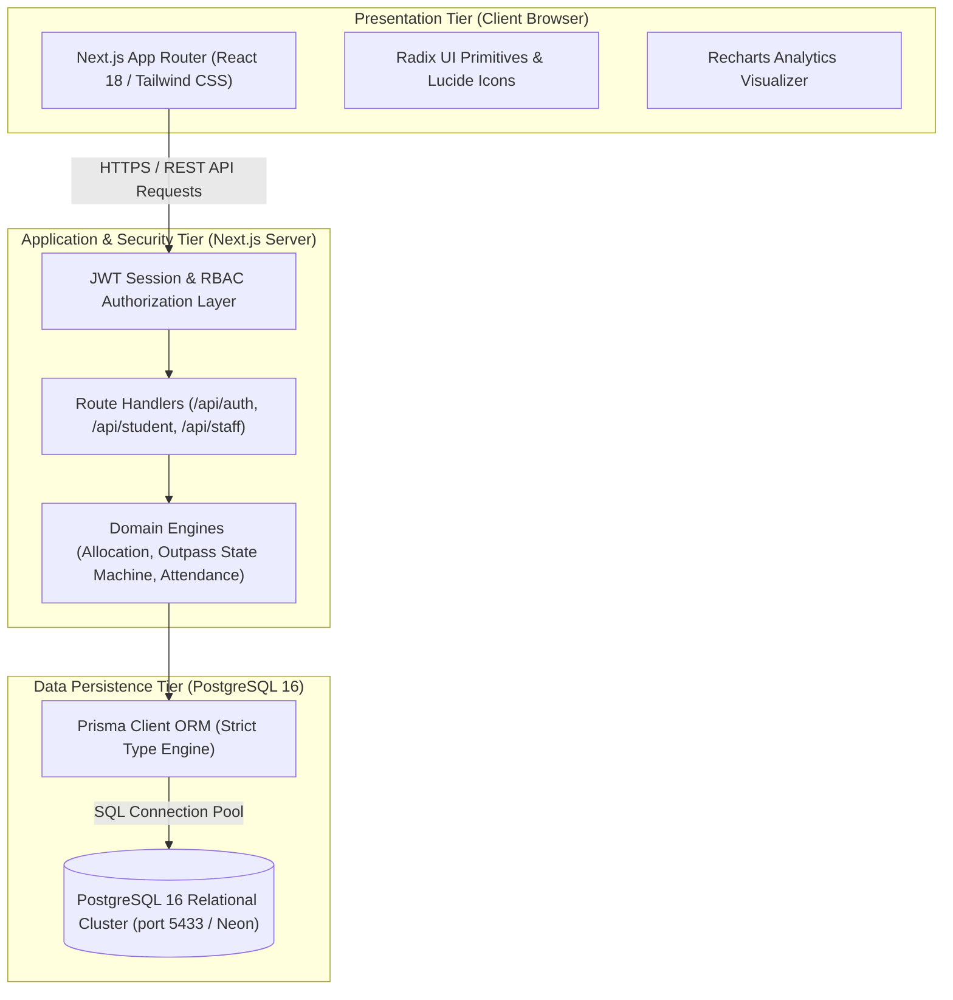
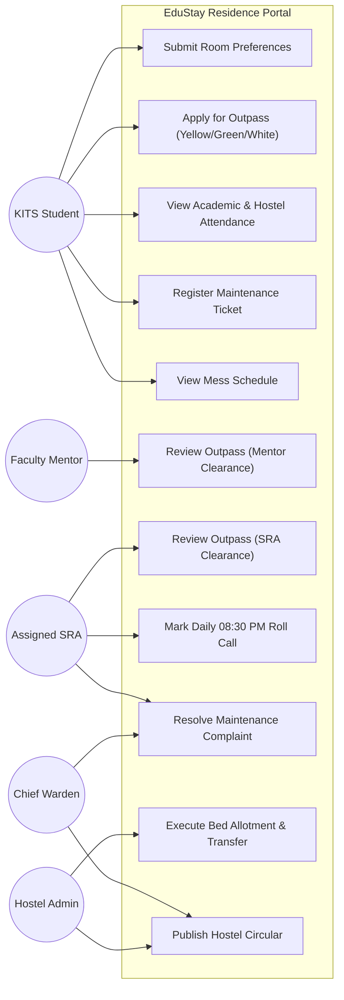
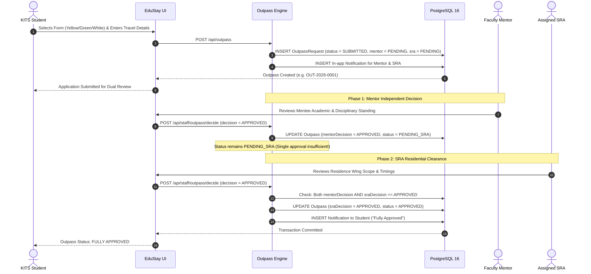
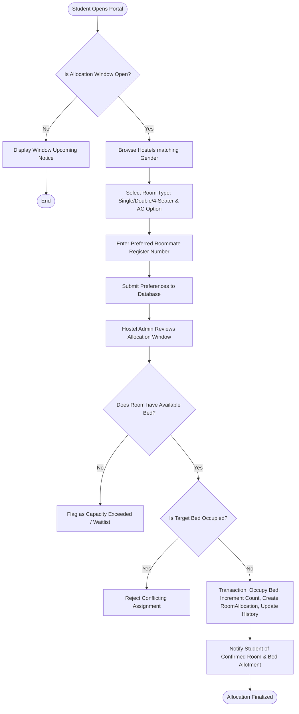
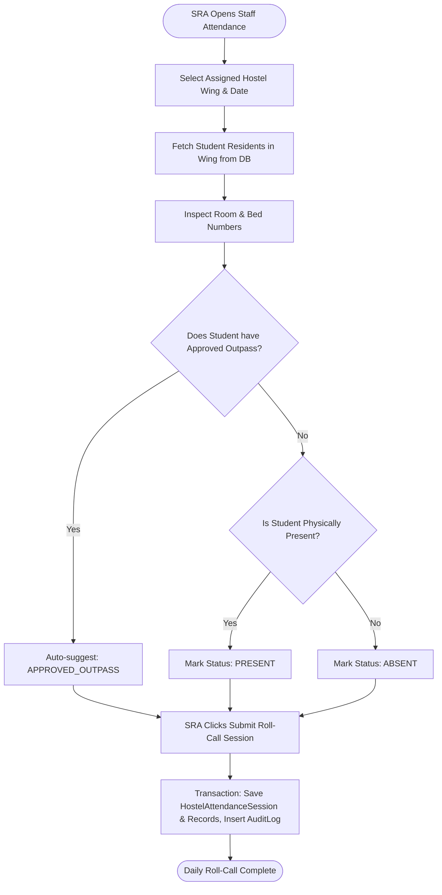
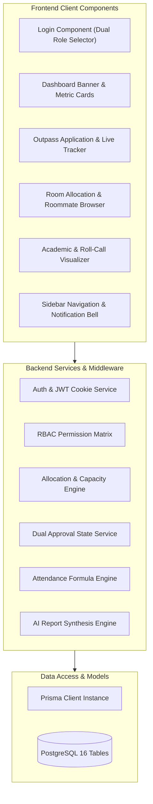
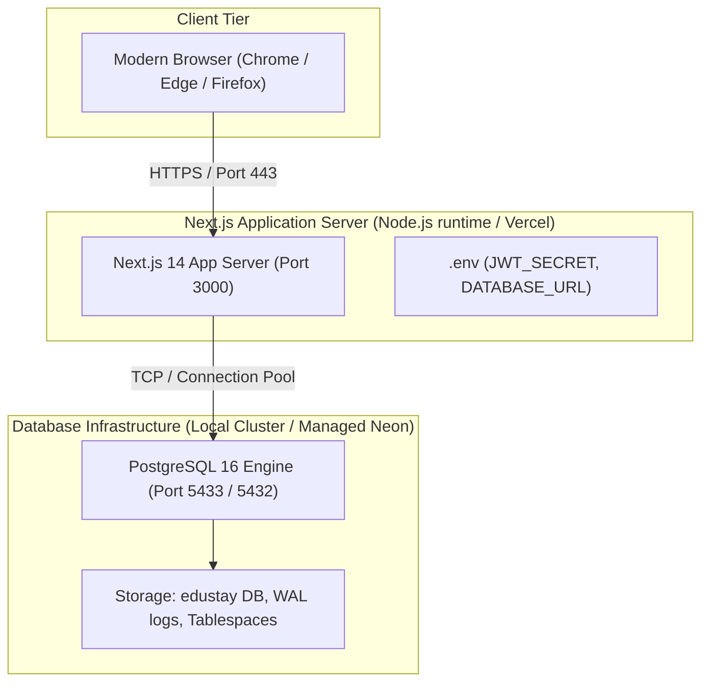

# 4. UML & System Architecture Diagrams
**EduStay: Karunya University Smart Hostel Management Portal**

---

## 4.1 System Architecture Diagram
The application follows a clean 3-tier decoupled architecture hosted with Next.js App Router and PostgreSQL 16 persistence:

---

## 4.2 Use Case UML Diagram

---

## 4.3 Sequence Diagram: Dual Outpass Authorization

---

## 4.4 Activity Diagram: Room Selection & Allotment Engine

---

## 4.5 Activity Diagram: Hostel Night Roll-Call Attendance

---

## 4.6 Component Diagram

---

## 4.7 Deployment Diagram

