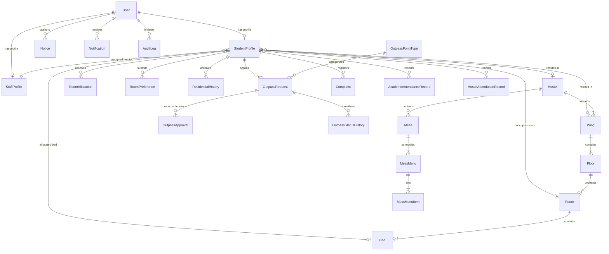

# 5. Database Design & Data Dictionary
**EduStay: Karunya University Smart Hostel Management Portal**

---

## 5.1 Entity-Relationship (ER) Diagram

---

## 5.2 Comprehensive Data Dictionary

### Table: `User`
| Column Name | Data Type | Constraints | Description |
| :--- | :--- | :--- | :--- |
| `id` | UUID / String | PRIMARY KEY | Unique identifier for institutional user |
| `email` | String | UNIQUE, NOT NULL | University email (`@karunya.edu` or `@karunya.edu.in`) |
| `identifier` | String | UNIQUE, NOT NULL | Register number (e.g. `URK25CS6015`) or Staff Code |
| `passwordHash`| String | NOT NULL | Bcrypt salted hash string |
| `fullName` | String | NOT NULL | Official legal student or faculty name |
| `role` | Enum (`Role`) | NOT NULL | Role: `STUDENT`, `MENTOR`, `SRA`, `WARDEN`, `HOSTEL_ADMIN`, `SYSTEM_ADMIN` |
| `phone` | String | NULLABLE | Primary mobile number |
| `isActive` | Boolean | DEFAULT true | Account status flag |
| `createdAt` | Timestamp | DEFAULT now() | Registration timestamp |

### Table: `StudentProfile`
| Column Name | Data Type | Constraints | Description |
| :--- | :--- | :--- | :--- |
| `id` | UUID / String | PRIMARY KEY | Profile unique identifier |
| `userId` | UUID / String | FOREIGN KEY, UNIQUE | Reference to `User.id` (1-to-1) |
| `department` | String | NOT NULL | Academic department (e.g. Computer Science & Engg) |
| `programme` | String | NOT NULL | Degree code (e.g. `B.Tech (CS6)`) |
| `academicYear`| String | NOT NULL | Academic year (e.g. `2025-2026`) |
| `semester` | Integer | NOT NULL | Current semester (1 - 8) |
| `cgpa` | Float | NOT NULL | Cumulative Grade Point Average |
| `arrearsCount`| Integer | DEFAULT 0 | Count of standing arrears |
| `classAttendancePct` | Float | DEFAULT 99.0 | Persisted academic attendance percentage |
| `assemblyAttendancePct`| Float | DEFAULT 100.0 | Daily assembly attendance percentage |
| `mentorId` | UUID / String | FOREIGN KEY | Assigned faculty mentor (`StaffProfile.id`) |
| `currentHostelId` | UUID | FOREIGN KEY | Reference to active `Hostel.id` |
| `currentRoomId` | UUID | FOREIGN KEY | Reference to active `Room.id` |
| `currentBedId` | UUID | FOREIGN KEY, UNIQUE | Reference to active `Bed.id` |

### Table: `Hostel`
| Column Name | Data Type | Constraints | Description |
| :--- | :--- | :--- | :--- |
| `id` | UUID / String | PRIMARY KEY | Unique hostel identifier |
| `name` | String | UNIQUE, NOT NULL | Father Duraisamy, P. R. Garg, Angelina, Hepzibah, etc. |
| `genderCategory` | Enum | NOT NULL | `MALE`, `FEMALE`, or `COED` |
| `buildingCode` | String | NOT NULL | Institutional building acronym (e.g. `FD-RES`) |
| `facilities` | String | NULLABLE | Wi-Fi, Solar Water, Gym, Badminton Court, etc. |
| `wardenId` | UUID / String | FOREIGN KEY | Assigned Chief Warden (`StaffProfile.id`) |

### Table: `Room`
| Column Name | Data Type | Constraints | Description |
| :--- | :--- | :--- | :--- |
| `id` | UUID / String | PRIMARY KEY | Unique room record ID |
| `roomNumber` | String | NOT NULL | E.g., `101`, `204` |
| `floorId` | UUID / String | FOREIGN KEY | Belongs to `Floor.id` |
| `roomType` | Enum | NOT NULL | `SINGLE`, `DOUBLE`, `FOUR_SEATER`, `SIX_SEATER` |
| `isAc` | Boolean | DEFAULT false | Air conditioning installed flag |
| `capacity` | Integer | NOT NULL | Maximum permitted bed occupants |
| `currentOccupancy` | Integer | DEFAULT 0 | Currently allocated student count |

### Table: `OutpassRequest`
| Column Name | Data Type | Constraints | Description |
| :--- | :--- | :--- | :--- |
| `id` | UUID / String | PRIMARY KEY | Unique outpass record identifier |
| `outpassNumber` | String | UNIQUE, NOT NULL | E.g., `OUT-2026-0001` |
| `studentId` | UUID / String | FOREIGN KEY | Applicant (`StudentProfile.id`) |
| `formTypeId` | UUID / String | FOREIGN KEY | Form type (`YELLOW`, `GREEN`, `WHITE`) |
| `destination` | String | NOT NULL | Place of visit |
| `departureTime` | Timestamp | NOT NULL | Permitted exit date and time |
| `expectedReturnTime` | Timestamp | NOT NULL | Scheduled mandatory return time |
| `status` | Enum | NOT NULL | `SUBMITTED`, `PENDING_SRA`, `PENDING_MENTOR`, `APPROVED`, `REJECTED`, `COMPLETED` |
| `mentorDecision` | Enum | DEFAULT PENDING | `PENDING`, `APPROVED`, `REJECTED` |
| `sraDecision` | Enum | DEFAULT PENDING | `PENDING`, `APPROVED`, `REJECTED` |
| `mentorId` | UUID / String | FOREIGN KEY | Assigned Mentor reviewer |
| `sraId` | UUID / String | FOREIGN KEY | Assigned SRA reviewer |
| `policyVersion` | String | NOT NULL | Institutional rule version under which filed |

### Table: `HostelAttendanceRecord`
| Column Name | Data Type | Constraints | Description |
| :--- | :--- | :--- | :--- |
| `id` | UUID / String | PRIMARY KEY | Unique attendance entry ID |
| `sessionId` | UUID / String | FOREIGN KEY | Belongs to `HostelAttendanceSession.id` |
| `studentId` | UUID / String | FOREIGN KEY | Resident student (`StudentProfile.id`) |
| `status` | Enum | NOT NULL | `PRESENT`, `ABSENT`, `APPROVED_OUTPASS`, `EXCUSED` |
| `remarks` | String | NULLABLE | Note (e.g. "Approved weekend outpass OUT-2026-0001") |

